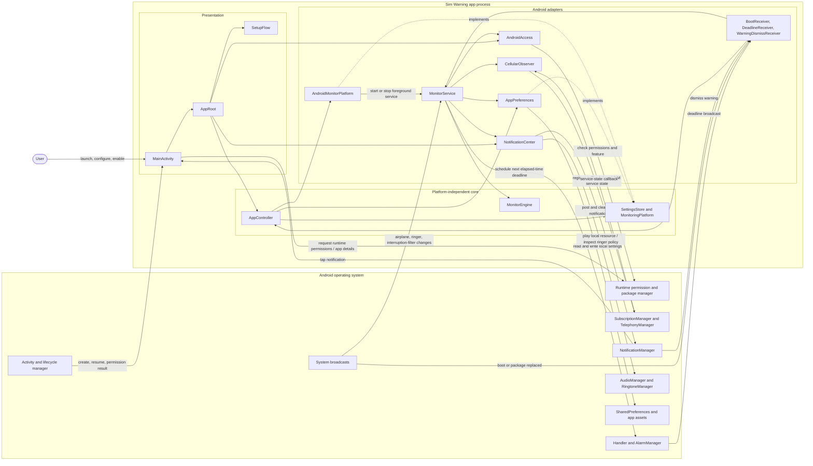
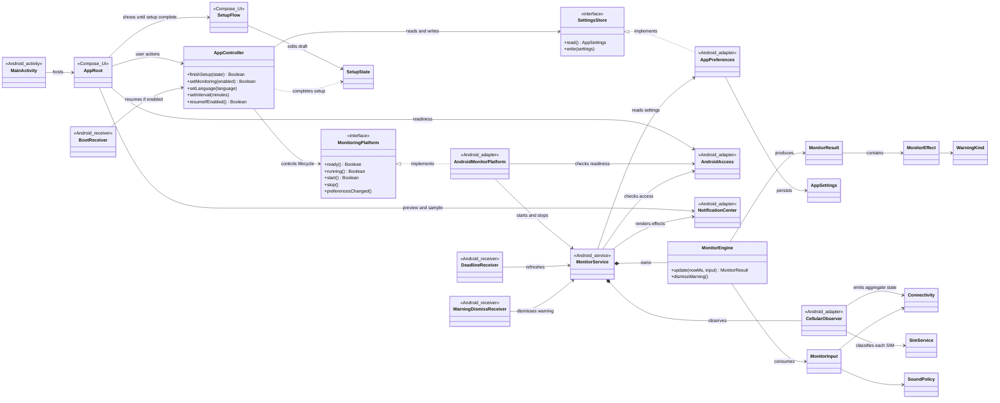
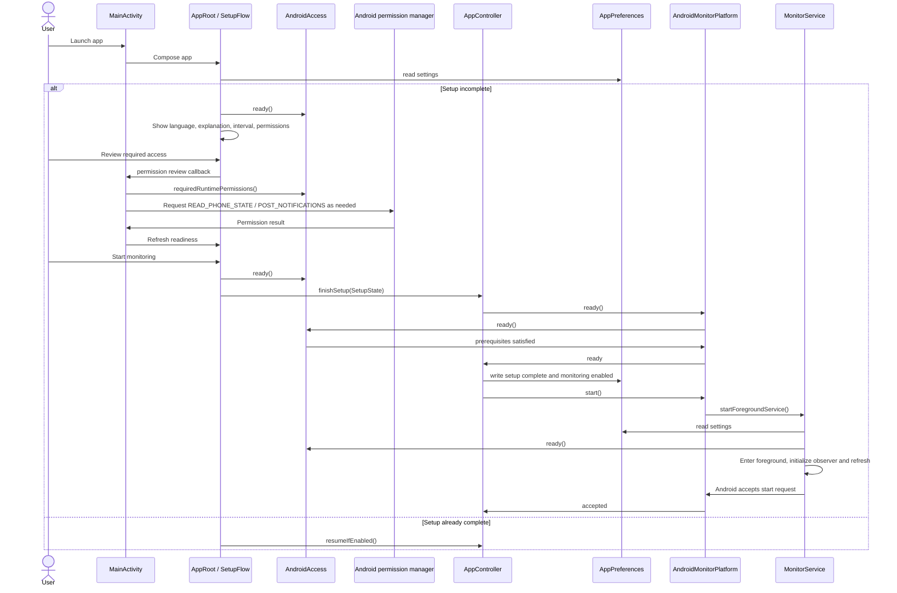
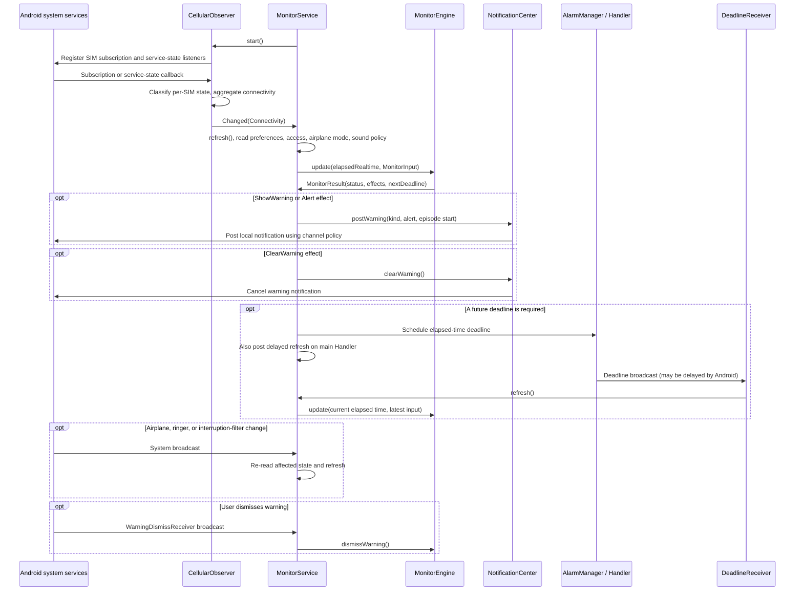
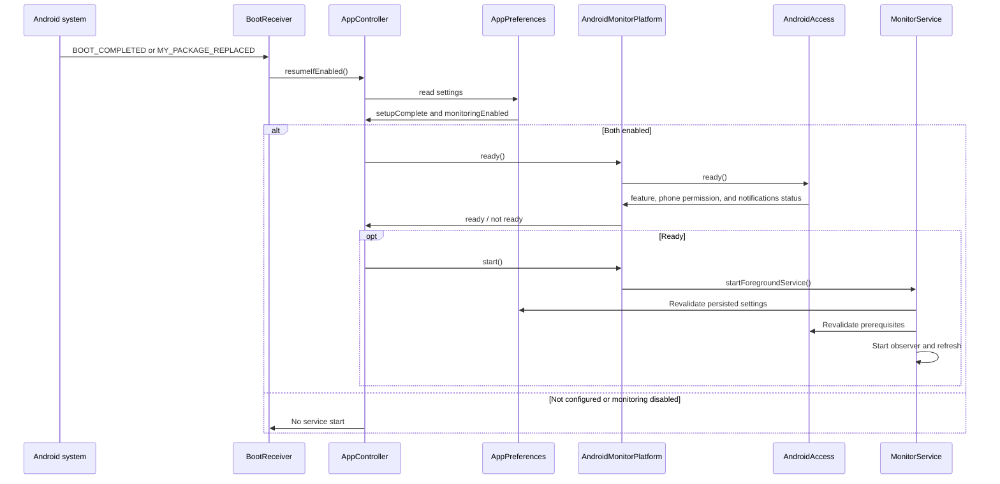
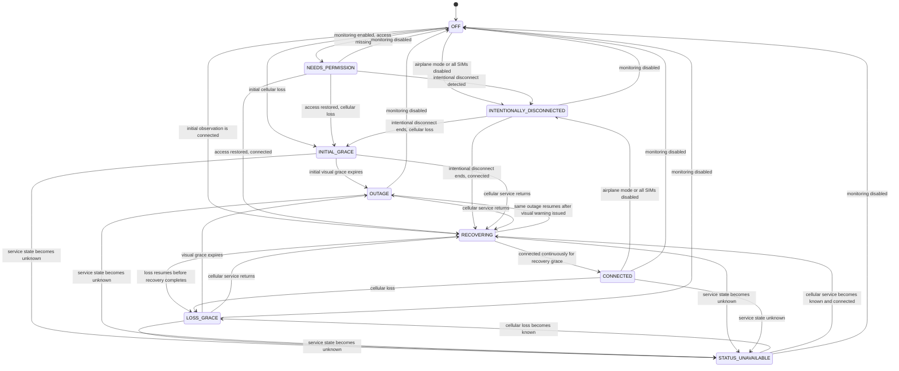

# Application Architecture UML

These diagrams describe the current Android implementation, including the boundary between app-owned logic and Android system services. The diagrams are intentionally split by concern: component boundary, class structure, user setup, live monitoring, boot recovery, and monitor states.

## Component And System Boundary

The app has no backend or internet endpoint. Android provides telephony observations, lifecycle/broadcast delivery, permissions, local persistence, alarms, and notification/audio facilities. Cellular registration is observed through Android's telephony API; the app does not open a network connection.

`MainActivity` is the launcher entry point. `MonitorService` and the receivers are app-private Android components; only the launcher activity is exported. System callback directions above represent Android API calls and callbacks, not app-to-app or internet communication.

## Class Structure

The core owns settings coordination and outage decisions. Android implementations satisfy the core interfaces and translate between Android APIs and core data types.

## Setup And Monitoring Start

Permissions are requested by the activity through Android's runtime permission flow. `AndroidAccess.ready()` is rechecked before setup completion and before service start. `AppController` persists settings transactionally around the start request and restores the prior settings if startup fails.

The start result means Android accepted the start request, not that monitoring has remained active indefinitely. The foreground service independently validates state at creation and on subsequent refreshes.

## Live Monitoring And Warning Delivery

Monitoring is event/deadline-driven. The service submits each observation and current settings to the core engine; the engine returns a status, effects, and at most the next required deadline. The adapter applies effects locally and schedules that deadline without periodic polling.

Telephony observations concern cellular registration, not Wi-Fi or general internet connectivity. Audio uses bundled sound resources; the app does not request exact-alarm or DND-policy access.

## Boot And Package-Update Recovery

When Android delivers `BOOT_COMPLETED` or `MY_PACKAGE_REPLACED`, the private boot receiver asks the same controller/platform path to resume only if setup and monitoring are enabled and prerequisites remain available.

## Monitor State Machine

This view summarizes externally visible `MonitorStatus` values. It omits internal episode timestamps and sound/vibration policy details; `MonitorEngine` remains the authoritative transition logic.

`INITIAL_GRACE` uses the initial five-minute visual grace. Later known connection-loss episodes use the configured warning interval as their grace. Recovery must remain connected for 30 seconds before the episode is cleared. Unknown service state is represented separately and uses its own ten-minute alert cadence.

## Source Map

- Core contracts and effects: [`MonitorContract.kt`](../core/src/main/kotlin/app/simwarning/core/MonitorContract.kt)
- Setup and lifecycle coordination: [`AppController.kt`](../core/src/main/kotlin/app/simwarning/core/AppController.kt)
- Outage state machine: [`MonitorEngine.kt`](../core/src/main/kotlin/app/simwarning/core/MonitorEngine.kt)
- Android component declarations and permissions: [`AndroidManifest.xml`](../app/src/main/AndroidManifest.xml)
- UI and permission entry points: [`MainActivity.kt`](../app/src/main/java/app/simwarning/MainActivity.kt), [`AppRoot.kt`](../app/src/main/java/app/simwarning/ui/AppRoot.kt), [`SetupFlow.kt`](../app/src/main/java/app/simwarning/setup/SetupFlow.kt)
- Service lifecycle and receivers: [`MonitorService.kt`](../app/src/main/java/app/simwarning/platform/MonitorService.kt)
- Telephony and Android adapters: [`CellularObserver.kt`](../app/src/main/java/app/simwarning/platform/CellularObserver.kt), [`AndroidAccess.kt`](../app/src/main/java/app/simwarning/platform/AndroidAccess.kt), [`AndroidMonitorPlatform.kt`](../app/src/main/java/app/simwarning/platform/AndroidMonitorPlatform.kt)
- Local persistence and notifications: [`AppPreferences.kt`](../app/src/main/java/app/simwarning/platform/AppPreferences.kt), [`NotificationCenter.kt`](../app/src/main/java/app/simwarning/platform/NotificationCenter.kt)